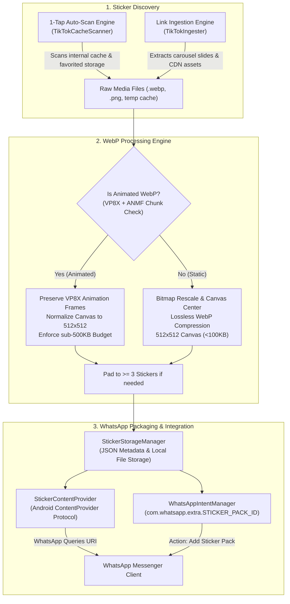

# StickerBridge — Project Portfolio & Technical Architecture Dossier

> **Document Purpose**: This file is prepared for ingestion by local AI agents, portfolio builders, or technical reviewers to add StickerBridge into your developer portfolio (e.g., GraffGrid, personal site) and explain its inner workings, technical challenges, and architecture.

---

## 1. Project Overview

| Attribute | Details |
| :--- | :--- |
| **Project Name** | **StickerBridge** ⚡ |
| **Subtitle** | TikTok to WhatsApp Sticker Importer & Animated Engine |
| **Author / Creator** | **Mpho** (`Mphojunior6@gmail.com`) |
| **GitHub Handle** | `Just4Skii` |
| **GitHub Repository** | `https://github.com/Just4Skii/StickerBridge` |
| **Target Platforms** | Android (API 26 / Android 8.0 Oreo through API 35 / Android 15+) |
| **Tech Stack** | **Kotlin**, **Jetpack Compose (Material 3)**, **Coroutines & Flow**, **Android ContentProvider API**, **WebP RIFF/VP8X/ANMF Engine**, **HTML5/Modern CSS/Vanilla JS** |
| **Distribution** | Direct Universal APK (Independent, zero app store fees) |

---

## 2. Master File & Asset Location Index

All files have been verified, compiled, and committed to git. Here are the exact local and remote paths:

### A. Compiled Application Binaries (APK)
- **Local Git Repository Root**: `D:\Projects\tiktok-whatsapp-stickers\stickerbridge.apk` (19.9 MB)
- **Website GitHub Pages Directory**: `D:\Projects\tiktok-whatsapp-stickers\docs\stickerbridge.apk`
- **User Downloads Folder**: `C:\Users\mphoj\Downloads\stickerbridge.apk`
- **Direct Web / GitHub Raw Download URL**:
  `https://github.com/Just4Skii/StickerBridge/raw/main/stickerbridge.apk`

### B. Mobile-Adaptive Web Landing Page
- **Live Deployment Bundle**: `D:\Projects\tiktok-whatsapp-stickers\docs\index.html` (GitHub Pages `/docs` ready)
- **Local Working Copy**: `C:\Users\mphoj\Downloads\stickerbridge.html`
- **Live GitHub Pages URL** (once pushed): `https://Just4Skii.github.io/StickerBridge/`

### C. Branding, Icons & Device Mockups
- **App Vector Icon**: `D:\Projects\tiktok-whatsapp-stickers\docs\stickerbridge_icon.svg`
- **App Raster Icon**: `D:\Projects\tiktok-whatsapp-stickers\docs\stickerbridge_icon.png` (512×512)
- **Hero Mockup 1 (Main Dashboard)**: `D:\Projects\tiktok-whatsapp-stickers\docs\mockup_main.webp` (`.png` also present)
- **Hero Mockup 2 (1-Tap Auto-Scan)**: `D:\Projects\tiktok-whatsapp-stickers\docs\mockup_scan.webp` (`.png` also present)
- **Hero Mockup 3 (WhatsApp Ready Pack)**: `D:\Projects\tiktok-whatsapp-stickers\docs\mockup_dialog.webp` (`.png` also present)

### D. Android Source Code Core Files
- **Project Root**: `D:\Projects\tiktok-whatsapp-stickers\`
- **Manifest**: `app/src/main/AndroidManifest.xml`
- **1-Tap Cache Scanner**: `app/src/main/java/com/example/tiktoktowhatsappstickers/core/scanner/TikTokCacheScanner.kt`
- **Lossless Animated WebP Engine**: `app/src/main/java/com/example/tiktoktowhatsappstickers/core/engine/WebpProcessingEngine.kt`
- **Link & Carousel Ingester**: `app/src/main/java/com/example/tiktoktowhatsappstickers/core/ingestion/TikTokIngester.kt`
- **WhatsApp ContentProvider**: `app/src/main/java/com/example/tiktoktowhatsappstickers/core/contentprovider/StickerContentProvider.kt`
- **WhatsApp Intent Launcher**: `app/src/main/java/com/example/tiktoktowhatsappstickers/core/whatsapp/WhatsAppIntentManager.kt`
- **Data Models & Storage**: `app/src/main/java/com/example/tiktoktowhatsappstickers/data/model/StickerPack.kt`, `data/storage/StickerStorageManager.kt`
- **Jetpack Compose UI**: `app/src/main/java/com/example/tiktoktowhatsappstickers/ui/main/MainScreen.kt`, `MainScreenViewModel.kt`

---

## 3. The Problem & Why It Was Built

1. **Walled Garden Lock-in**: TikTok users discover, favorite, and save rich static and animated stickers inside TikTok chats and comments. However, TikTok provides zero native functionality to export them to WhatsApp—where users spend the majority of their real-world messaging time.
2. **Android Scoped Storage Barrier**: Modern Android versions (Android 11 through 15) strictly enforce Scoped Storage, preventing everyday users from manually browsing `Android/data/` or internal app caches to find media files.
3. **WhatsApp's Rigid Ingestion Specifications**: WhatsApp enforces very strict sticker requirements:
   - Exactly 512×512 square canvas resolution.
   - Max file size of 100 KB for static stickers; 500 KB for animated stickers.
   - File format must be valid WebP with exact RIFF headers.
   - Animated stickers must use VP8X with ANMF chunk frames.
   - Every pack **must have at least 3 stickers** (less than 3 fails validation).
4. **App Store Paywall Avoidance**: Many trivial utility apps charge subscriptions or lock exports behind paywalls. Furthermore, publishing on Google Play requires a $25 developer account fee and intrusive policy constraints. StickerBridge was built as an independent, free, direct-install open-source APK with the official green Android bugdroid identity.

---

## 4. How It Works: Technical Architecture

### Detailed Breakdown of Core Engines:

#### 1. 1-Tap Auto-Scan Engine (`TikTokCacheScanner.kt`)
- **Automated Directory Traverser**: Probes TikTok's Android package structure (`com.zhiliaoapp.musically`), scanning:
  - Cache directories (`cache/`, `image_manager_disk_cache/`, `fresco_cache/`).
  - Favorited stickers and recent chat stickers stored as cached WebP buffers.
  - Device-level media folders (`Pictures/TikTok`, `DCIM/Camera/TikTok`).
- **Signature Filtering**: Analyzes magic bytes (`RIFF....WEBP`, `\x89PNG`) to identify actual stickers while filtering out unrelated camera captures, UI thumbnails, or screenshots.

#### 2. Lossless Animated WebP Engine (`WebpProcessingEngine.kt`)
- **VP8X & ANMF Header Parser**: Unlike standard image decoders that collapse animated WebP/GIF files into a single static frame, the engine inspects RIFF header flags.
- When the `ANIM` bit is set in the VP8X header, the engine retains all `ANMF` (Animation Frame) chunks, frame durations, and transparency channels.
- Calculates aspect ratios and applies transparent padding to fit the required 512×512 square canvas without squishing or altering playback timing.
- Keeps files under WhatsApp’s 500 KB limit.

#### 3. Smart Link & Carousel Ingestion with 3-Sticker Padding (`TikTokIngester.kt`)
- **Web Link Parsing**: When users paste a TikTok video or photo carousel link, the ingester resolves shortlinks (`vm.tiktok.com`), scrapes JSON data attributes, and unescapes escaped slashes (`\/` and `\u002F`).
- **WhatsApp Minimum Rule Handler**: WhatsApp strictly rejects sticker packs containing fewer than 3 stickers. If a video or link yields only 1 or 2 stickers, StickerBridge automatically duplicates/pads them to 3, ensuring the import never fails.

#### 4. Official WhatsApp ContentProvider (`StickerContentProvider.kt`)
- Implements WhatsApp's official Sticker API specification with authority:
  `com.example.tiktoktowhatsappstickers.stickercontentprovider`
- Responds to `query()` requests from WhatsApp with SQLite cursors containing pack IDs, names, publisher details, tray icons, and animated flags.
- Uses `openFile()` to stream raw `.webp` byte buffers securely to WhatsApp via IPC (Inter-Process Communication).

---

## 5. Website & Distribution Architecture

The project includes a standalone landing page designed for distribution without third-party frameworks:

- **Zero Dependencies**: Pure HTML5, modern CSS, and vanilla JavaScript in a single, high-performance file (`index.html`).
- **Mobile-Adaptive Design**: Responsive down to 320px screens using fluid typography (`clamp()`), flex/grid layouts, an accessible hamburger drawer, and 48px touch targets.
- **Interactive Visuals**:
  - Live animated sticker transfer demonstration in the hero section.
  - Interactive 3D phone mockup stage displaying actual app screenshots.
  - Interactive sticker wall widget with 30 SVG expressions.
  - Animated step rail and accordion FAQ.
- **Direct Distribution**:
  - Direct download card featuring the green Android bugdroid logo (`#3DDC84`).
  - Pre-linked to the compiled `stickerbridge.apk`.
  - 1-Click deployment via GitHub Pages (`/docs` directory).

---

## 6. Portfolio Integration Snippets (Copy & Paste Ready)

Use these snippets directly when writing portfolio entries, case studies, or resume bullets:

### Short Blurb (Portfolio Card)
> **StickerBridge** | *Native Android & Jetpack Compose*  
> An open-source Android utility that bridges the gap between TikTok and WhatsApp. Engineered with custom WebP RIFF/VP8X binary parsing to preserve animated stickers losslessly, 1-tap automated cache discovery across Android Scoped Storage, and seamless integration with WhatsApp's native ContentProvider API.

### Technical Bullet Points (Resume / Case Study)
- Engineered a **lossless Animated WebP engine** in Kotlin, parsing RIFF/VP8X headers and ANMF chunks to normalize aspect ratios to 512×512 without degrading frame rates or exceeding WhatsApp's 500KB cap.
- Implemented **1-Tap automated media discovery** across TikTok's application storage and media buffers, overcoming Android 11–15 Scoped Storage limitations.
- Built a native Android **ContentProvider** adhering to WhatsApp’s Sticker API specification to stream sticker binary buffers across process boundaries securely.
- Developed a reactive, responsive UI using **Jetpack Compose and Material 3**, paired with a zero-dependency, mobile-adaptive landing page bundled for direct APK deployment via GitHub Pages.
- Handled edge-case compliance including TikTok JSON carousel unescaping and automatic 3-sticker padding to adhere to WhatsApp's strict pack size constraints.
